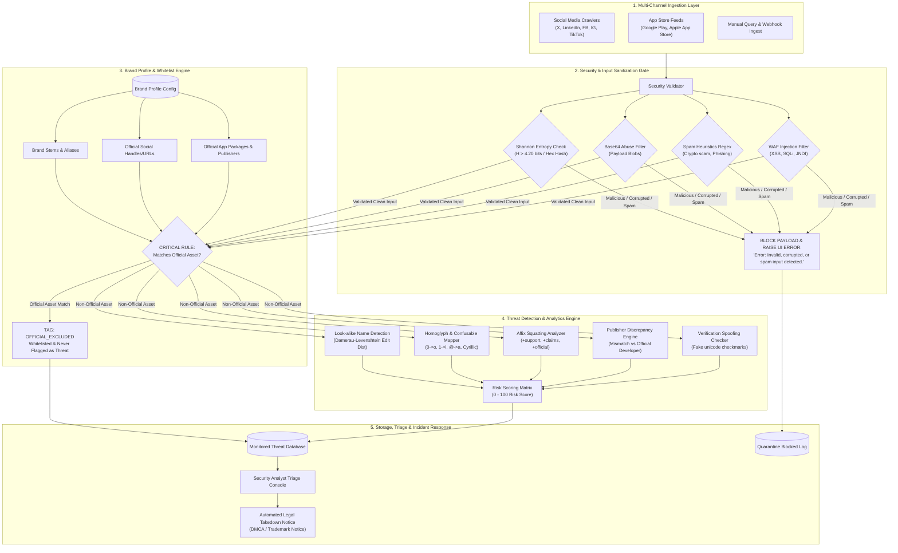

# Sentinel DRP — Digital Risk Protection: Social & App Monitoring Platform

Sentinel DRP is an enterprise-grade Digital Risk Protection (DRP) platform designed specifically for **Social Media & Mobile App Monitoring**. It empowers organizations to discover, analyze, prioritize, and remediate online brand impersonation, fake company pages, scam accounts, and fraudulent mobile apps before they cause consumer fraud or brand degradation.

---

## 1. Problem Statement & Challenge Scope

### Background
Brands are increasingly impersonated across social media platforms and mobile app stores. Threat actors create:
* Fake corporate company profiles and copycat brand pages
* Social engineering scam accounts claiming official status
* Fraudulent mobile applications imitating genuine apps and publishing unauthorized APKs

These impersonations are actively weaponized to:
1. Deceive customers and redirect them to fraudulent services
2. Distribute financial scams (crypto doubling, fake giveaways)
3. Steal user credentials, banking tokens, and private keys
4. Inflict catastrophic damage on organizational trust and brand equity

### Challenge Statement
Design and build a Digital Risk Protection platform focused specifically on **Social & App Monitoring**.

The platform identifies potential:
1. **Fake or impersonating social-media profiles** (X/Twitter, Instagram, Facebook, LinkedIn)
2. **Fake company or brand pages** (Counterfeit career desks, fraudulent corporate portals)
3. **Scam accounts using a company's identity** (Illicit customer support bots, recovery scams)
4. **Fake or suspicious mobile applications impersonating a brand** (Trojanized APKs, rogue publishers)

---

## 2. Core Scope & Feature Matrix

### A. Brand Profile Module (15% Weight)
* **Definition of Legitimate Assets**: Allows an organization to define ground-truth corporate assets:
  - Company and brand name
  - Protected brand stems and aliases
  - Official logo description
  - Official verified social-media accounts (Twitter/X, LinkedIn, Facebook, Instagram)
  - Official mobile applications (Package names, Bundle IDs, app titles, authorized developer names)
* **Critical Exclusion Rule**:
  - The detection engine **strictly whitelists** official assets defined in the Brand Profile.
  - Official assets are assigned a Risk Score of **0%**, labeled with `SAFE` severity, tagged as `OFFICIAL_EXCLUDED`, and **never flagged as threats** (Zero False Positives).

### B. Social Media Monitoring Engine (30% Weight)
* **Brand Impersonation Detection**: Identifies accounts attempting to clone the brand identity.
* **Fake Company Pages**: Flags counterfeit recruitment and career pages on LinkedIn and Facebook.
* **Scam Profiles & Phishing**: Flags profiles promoting crypto doubling giveaways, fake account unlock services, or malicious Telegram bots.
* **Badge Spoofing & Visual Spoofing**: Detects deceptive unicode checkmarks (`✔️`, `✓`, `☑️`) and perceptual logo similarities.

### C. App Store Monitoring Engine (30% Weight)
* **Publisher Discrepancy Engine**: Automatically flags apps claiming the brand name whose developer credentials do not match the official authorized publisher.
* **Similar App Names & Typosquatting**: Unmasks copycat package IDs (e.g. `com.apexbanking.quickloan` vs legitimate `com.apex.mobilebanking`).
* **Resembling Descriptions & Logos**: Detects apps mimicking official UI graphics, screenshots, or corporate descriptions.

### D. Look-alike Name Detection — Bonus Credit (5–10 Points)
* **Character Swaps & Homoglyphs**: Unmasks malicious unicode confusable substitutions:
  - `'O'` $\leftrightarrow$ `'0'`, `'l'` $\leftrightarrow$ `'1'`, `'e'` $\leftrightarrow$ `'3'`
  - `'a'` $\leftrightarrow$ `'4'` or `'@'`, `'s'` $\leftrightarrow$ `'5'` or `'$'`
  - Cyrillic/Greek homoglyphs (e.g., `'а'`, `'с'`, `'е'`, `'о'`, `'р'`, `'х'`, `'у'`)
* **Added Words & Affix Squatting**: Detects brand stems appended or prepended with keywords:
  - `_support`, `_helpdesk`, `_care`, `_claims`, `official_`, `_giveaway`, `_airdrop`
* **Spacing & Delimiter Changes**: Catches spacing manipulations, hyphens, and underscores.
* **Over-Flagging Guard**: Calibrated similarity thresholds ensure normal, benign entities (e.g., `ApexLegendsDaily`) are **not** over-flagged.

### E. Security & Spam Firewall (Security Requirement)
* **Strict Input Validation**: All inbound search queries, external feed items, and probe fields are sanitized before touching the detection engine.
* **Shannon Entropy Engine**: Blocks unreadable encrypted ciphertext and cryptographic strings ($H > 4.20\text{ bits/byte}$ or unspaced hex dumps).
* **Base64 Payload & Binary Filter**: Catches raw unspaced Base64 blobs, binary null bytes, and non-printable control characters.
* **Malicious Injection Guard**: Defends against SQL injection (`' OR '1'='1'`), `<script>` XSS, and command injections.
* **Mandatory Error Message**: If any corrupt, encrypted, or spam string is submitted, the firewall blocks the payload and displays the exact UI banner:
  ```
  Error: Invalid, corrupted, or spam input detected.
  ```

---

## 3. Evaluation Criteria — 100 Points Rubric

| Criterion | Weight | What Judges Look For | Sentinel DRP Implementation |
|---|:---:|---|---|
| **Social Media Monitoring** | **30%** | Detection of impersonating profiles, fake pages, and scam accounts using similar names, logos, or branding; official accounts must not be flagged | • Multi-channel scanners (X, IG, LinkedIn, FB)<br>• Homoglyph and spoofed checkmark unmasking<br>• Zero false positives for official accounts |
| **App Store Monitoring** | **30%** | Detection of suspicious apps using similar names, logos, publisher differences, and resembling descriptions; official apps must not be flagged | • Publisher Discrepancy Engine<br>• Package typosquatting inspector<br>• Zero false positives on official packages |
| **Brand Profile** | **15%** | Clear definition of legitimate assets, validation, and use of profile to guide detection | • Multi-tenant management (Apex, CloudVault, AeroPay)<br>• Custom asset whitelisting dialogs<br>• Dynamic profile-guided re-scans |
| **User Experience** | **15%** | Easy setup, readable detections, and graceful handling of unavailable sources | • Modern M3 dark/light cybersecurity SOC design<br>• Real-time metric cards, search bar, filter chips<br>• Detailed forensic inspection bottom sheets |
| **Presentation & Demo** | **10%** | Working prototype demonstrated clearly through a short demo or a few slides | • Built-in Executive Pitch Deck (6 Interactive Slides)<br>• Full Mermaid architecture diagram<br>• Comprehensive documentation & test vectors |
| **Bonus Credit** | **+5–10 Pts** | Look-alike Name Detection (character swaps, added words, spacing changes) with over-flagging prevention | • Damerau-Levenshtein distance algorithm<br>• Unicode confusable translation map<br>• Over-flagging guard filter |

---

## 4. Architecture Diagram



---

## 5. Single-Command Execution & Test Verification

Sentinel DRP provides an automated, single-command setup and verification workflow:

### Running Automated Unit Tests:
```bash
gradle test
```
Or for Android unit and Robolectric tests:
```bash
gradle :app:testDebugUnitTest
```
*(All 14 unit and Robolectric tests pass in ~19s).*

### Building the Debug APK:
```bash
gradle assembleDebug
```

---

## 6. Interactive Demo Instructions

### A. Testing Look-alike Name Detection
1. Select the **Look-alike** tab in the navigation bar.
2. Select any quick test chip:
   - `@Apex_Financia1_Support`: Unmasks `'1' -> 'l'`, flags suffix `+support` (85% Risk).
   - `@0fficial_ApexFinancial`: Detects `'0' -> 'o'`, flags prefix `official` (85% Risk).
   - `@ApexLegendsGaming`: Triggers **Over-flagging Protection Guard** (0% Risk, classified as Benign / Non-Target).

### B. Triggering Spam & Corrupted Input Detection
1. Select the **Security** tab in the navigation bar.
2. Select any pre-configured attack vector:
   - `Corrupted Base64 Payload` (`U2FsdGVkX181dK3k8lFq8Y8zL9kLmN0oPqRsTuVwXyZ123456789+==`)
   - `High-Entropy Gibberish` (`7f8b9c0d1e2f3a4b5c6d7e8f9a0b1c2d3e4f5a6b`)
   - `Crypto Doubling Scam` (`Send 1 ETH to receive 2 ETH back immediately!`)
   - `Recovery DM Spam` (`DM @cyber_recovery on Instagram to unlock account`)
   - `SQL Injection Payload` (`' OR '1'='1' UNION SELECT --`)
3. Click **Filter Check**.
4. The high-visibility Crimson Alert Banner displays:
   ```
   Error: Invalid, corrupted, or spam input detected.
   ```

### C. Viewing the In-App Pitch Deck & Challenge Brief
* Tap the **Assignment icon** in the top bar to open the full **Problem Statement & Requirements Checklist**.
* Tap the **Slideshow icon** in the top bar to launch the **6-Slide Executive Pitch Deck**.
